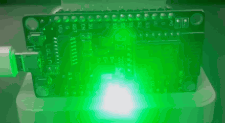
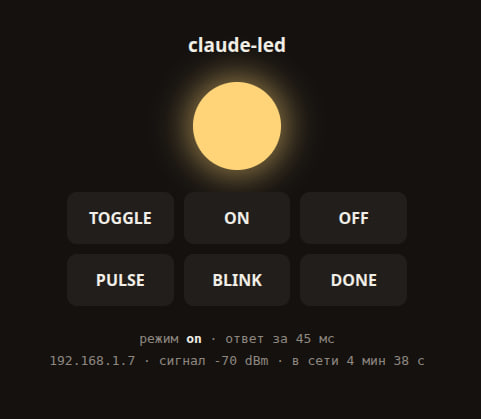

# claude-ready-led

ESP8266 पर लगा एक LED, जो **Claude Code के काम शुरू करते ही बुझ जाता है** और
**काम खत्म होते ही जल उठता है**। साथ में एक सिस्टम-वाइड `Ctrl+T` शॉर्टकट, ताकि
इसे हाथ से भी टॉगल किया जा सके।

[English](../README.md) ·
[Русский](README.ru.md) ·
[简体中文](README.zh-CN.md) ·
[Español](README.es.md) ·
**हिन्दी** ·
[العربية](README.ar.md) ·
[Português](README.pt-BR.md) ·
[Français](README.fr.md) ·
[Deutsch](README.de.md) ·
[日本語](README.ja.md) ·
[한국어](README.ko.md)

<p align="center">
  
  
</p>

हार्डवेयर: NodeMCU v3 (ESP8266) और कोई भी LED। सॉफ़्टवेयर: बिल्ट-इन HTTP सर्वर वाला
फ़र्मवेयर, Claude Code हुक, और एक ग्लोबल XFCE शॉर्टकट।

---

## हुक इंस्टॉल करें

```bash
curl -fsSL https://raw.githubusercontent.com/makhnanov/claude-ready-led/main/scripts/install.sh | bash
```

यह रिपॉज़िटरी को `~/.claude-ready-led` में क्लोन करता है, हुक `~/.claude/settings.json`
में लिखता है (`settings.json.bak` में बैकअप रखते हुए), डिवाइस का पता
`~/.claude-led.conf` में सहेजता है, और जाँचता है कि बोर्ड जवाब दे रहा है या नहीं।
दोबारा चलाना सुरक्षित है: यह सिर्फ़ अपनी ही एंट्रियाँ बदलता है, बाकी हुक को हाथ नहीं लगाता।

अगर mDNS नाम रिज़ॉल्व न हो, तो पता सीधे दें:

```bash
curl -fsSL https://raw.githubusercontent.com/makhnanov/claude-ready-led/main/scripts/install.sh \
  | CLAUDE_LED_URL=http://192.168.1.7 bash
```

इसके बाद Claude Code में `/hooks` खोलें (इससे कॉन्फ़िग दोबारा पढ़ी जाती है) या उसे रीस्टार्ट करें।

---

## वायरिंग

`D6` यानी `GPIO12`।

```
D6 ──[ 220–330 Ω ]──▶| LED ──── GND
                   एनोड   कैथोड
                (लंबी टाँग) (छोटी टाँग,
                            किनारे पर चपटा हिस्सा)
```

रेसिस्टर ज़रूरी है: ESP8266 का एक पिन ज़्यादा से ज़्यादा लगभग 12 mA ही दे सकता है।

---

## फ़र्मवेयर

```bash
cp firmware/claude_led/secrets.h.example firmware/claude_led/secrets.h
$EDITOR firmware/claude_led/secrets.h          # SSID और पासवर्ड, सिर्फ़ 2.4 GHz

arduino-cli core install esp8266:esp8266
arduino-cli compile --fqbn esp8266:esp8266:nodemcuv2 --upload -p /dev/ttyUSB0 firmware/claude_led
```

या यही काम स्क्रिप्ट से — वह ख़ुद कोर इंस्टॉल करती है, उदाहरण से `secrets.h` बनाती है और पोर्ट
भी ख़ुद ढूँढ़ लेती है:

```bash
scripts/flash.sh              # मुख्य बोर्ड
scripts/flash.sh button       # वायरलेस बटन (नीचे देखें)
scripts/flash.sh button -m    # और उसके बाद सीरियल मॉनिटर खोलें
```

`secrets.h` `.gitignore` में है, इसलिए आपका Wi-Fi पासवर्ड कभी रिपॉज़िटरी तक नहीं पहुँचता।
git में सिर्फ़ प्लेसहोल्डर वाली `secrets.h.example` रहती है।

मिला हुआ IP पता करें:

```bash
arduino-cli monitor -p /dev/ttyUSB0 -c baudrate=115200   # बूट होते ही बोर्ड अपना IP छापता है
ping claude-led.local                                    # या mDNS के ज़रिए
```

---

## HTTP API

| रिक्वेस्ट | असर |
|---|---|
| `GET /on` | लगातार जलना |
| `GET /off` | बुझाना |
| `GET /toggle` | टॉगल: बुझा हो तो जलाओ, बाकी किसी भी हाल में बुझाओ |
| `GET /pulse` | धीमी साँस जैसी चमक — Claude काम कर रहा है |
| `GET /blink?times=3&ms=200` | झपकना |
| `GET /done` | 3 तेज़ झपकियाँ, फिर जलता रहना — काम पूरा |
| `GET /status` | JSON: मोड, IP, RSSI, अपटाइम |
| `GET /` | वेब इंटरफ़ेस (नीचे देखें) |

अगर `secrets.h` में `API_TOKEN` सेट है, तो हर रिक्वेस्ट के साथ `?token=...` देना होगा।

## CLI

```bash
scripts/led.sh on | off | toggle | pulse | done | blink 5 100 | status
scripts/led.sh find     # बोर्ड को नेटवर्क में खोजें और उसका पता याद रखें
scripts/led.sh where    # अभी जो पता इस्तेमाल हो रहा है, वह दिखाएँ
```

पता `CLAUDE_LED_URL` (एनवायरनमेंट या `~/.claude-led.conf`) से आता है, नहीं तो
`~/.cache/claude-led/ip` में कैश किए गए IP से। यह कैश `find` लिखता है, और याद रखा गया
पता जवाब देना बंद कर दे तो स्क्रिप्ट खुद ही उसे ताज़ा कर लेती है (ज़्यादा से ज़्यादा
मिनट में एक बार — देखें `CLAUDE_LED_SCAN_COOLDOWN`)। यानी DHCP लीज़ बदल जाए तो वह अपने
आप ठीक हो जाता है, कोई कॉन्फ़िग छूने की ज़रूरत नहीं।

हुक से या हॉटकी से चलाने पर — यानी जहाँ भी stdout टर्मिनल नहीं है — LED पर असर डालने
वाली कमांड तुरंत अलग हो जाती है और नेटवर्क का काम बैकग्राउंड में करती है: कुछ मिलीसेकंड
में लौट आती है और हमेशा 0 के साथ बाहर निकलती है — इसीलिए इसे हुक पर लगाना सुरक्षित है।
टर्मिनल में हाथ से टाइप करने पर वह पहले की तरह सामने ही रहती है और बोर्ड का जवाब छापती
है। `CLAUDE_LED_WAIT=1` हमेशा इंतज़ार कराता है, `CLAUDE_LED_WAIT=0` कभी नहीं।

ध्यान दें कि हुक वाले रास्ते पर `claude-led.local` कभी हल नहीं किया जाता: नाकाम mDNS
पूछताछ पूरे 5 सेकंड लेती है, और बोर्ड बंद होने पर हुक का समय यही फोड़ती थी। नाम हल करना
सिर्फ़ `find` के भीतर होता है। कैश किया पता चुप रहे तो `find` आपके लोकल `/24` को भी
टटोलता है — सिर्फ़ पोर्ट 80, हर होस्ट पर एक बार। जिस नेटवर्क में यह ठीक न लगे, वहाँ पता
`CLAUDE_LED_URL` से तय कर दें।

---

## वेब इंटरफ़ेस

ब्राउज़र में `http://claude-led.local/` खोलें — कंप्यूटर से या फ़ोन से, क्योंकि mDNS
पूरे लोकल नेटवर्क में काम करता है। बोर्ड खुद एक पेज परोसता है जिसमें TOGGLE / ON / OFF /
PULSE / BLINK / DONE बटन हैं, मौजूदा मोड दिखाता एक "बल्ब" है, और लाइव स्टेटस है:
IP, सिग्नल की ताक़त, अपटाइम।

**बटन पेज रीलोड नहीं करते।** क्लिक `fetch("/on")` भेजता है, JSON जवाब आते ही स्टेटस और
बल्ब तुरंत दोबारा बन जाते हैं। इसके अलावा पेज हर 2 सेकंड में खुद `/status` माँगता है,
इसलिए अगर LED को Claude Code का हुक या फ़ोन बदल दे, तो टैब को पता चल जाता है। टैब छिपा
होने पर पोलिंग रुक जाती है (`document.hidden`), ताकि बोर्ड बेवजह परेशान न हो।

कनेक्शन टूटने पर बल्ब लाल हो जाता है और "बोर्ड से कनेक्शन नहीं" दिखता है — पेज चुपचाप
अटका नहीं रहता।

### पेज का कोड कहाँ है

अलग फ़ाइल है ही नहीं: बोर्ड में कोई फ़ाइल सिस्टम नहीं होता। पूरा पेज
`firmware/claude_led/claude_led.ino` में बस एक C++ स्ट्रिंग है:

```cpp
static const char PAGE_HTML[] PROGMEM = R"HTML(<!doctype html> ... )HTML";

void handleRoot() {
  server.send_P(200, PSTR("text/html; charset=utf-8"), PAGE_HTML);
}
```

`PROGMEM` इसे कोड के साथ फ़्लैश में रखता है और `send_P` इसे सीधे वहीं से भेजता है, RAM
में कॉपी किए बिना। ठीक इसीलिए स्टेटस को HTML में जोड़ने के बजाय अलग `/status` रिक्वेस्ट
से लिया जाता है: पेज स्टैटिक रहता है और उसे बनाने के लिए RAM की ज़रूरत ही नहीं पड़ती।
इस तरीके पर जाने से 80 KB में से करीब 650 बाइट बचे — माइक्रोकंट्रोलर पर यह मायने रखता है।

अगर `secrets.h` में `API_TOKEN` सेट है, तो पेज ऐसे खोलें:
`http://claude-led.local/?token=xxxx` — यह एड्रेस बार से टोकन उठा लेगा और अपनी सारी
रिक्वेस्ट में जोड़ देगा।

---

## Claude Code हुक

`install.sh` `~/.claude/settings.json` में यह जोड़ता है:

```json
"hooks": {
  "UserPromptSubmit": [{ "hooks": [{ "type": "command",
    "command": "/path/to/scripts/led.sh off >/dev/null 2>&1", "timeout": 5 }] }],
  "Stop": [{ "hooks": [{ "type": "command",
    "command": "/path/to/scripts/led.sh done >/dev/null 2>&1", "timeout": 5 }] }]
}
```

- `UserPromptSubmit` — आपने प्रॉम्प्ट भेजा और Claude ने काम शुरू किया: LED बुझ जाता है।
- `Stop` — Claude ने जवाब पूरा किया: तीन झपकियाँ और फिर लगातार रोशनी।

यानी **जल रहा है = नतीजा तैयार है, बुझा है = अभी सोच रहा है**। अगर आप चाहें कि काम के
दौरान वह बुझने के बजाय साँस ले, तो हुक में `off` की जगह `pulse` कर दें।

आउटपुट जानबूझकर `/dev/null` में भेजा जाता है: वरना `UserPromptSubmit` हुक का stdout
मॉडल के कॉन्टेक्स्ट में चला जाता है।

देखने या बंद करने के लिए Claude Code में `/hooks` इस्तेमाल करें।

---

## Ctrl+T — LED टॉगल करें

```bash
scripts/hotkey-xfce.sh install    # लगाएँ
scripts/hotkey-xfce.sh status     # जाँचें
scripts/hotkey-xfce.sh remove     # हटाएँ
```

`xfconf` के ज़रिए एक ग्लोबल XFCE शॉर्टकट रजिस्टर करता है:

```
/commands/custom/<Primary>t  ->  /path/to/scripts/led.sh toggle
```

बुझा हो तो जलेगा, जल रहा हो या साँस ले रहा हो तो बुझेगा। पूरे सिस्टम में काम करता है,
तुरंत लागू होता है और रीबूट के बाद भी बना रहता है।

**ध्यान दें:** XFCE इस की-कॉम्बिनेशन को ग्लोबली पकड़ लेता है, इसलिए `Ctrl+T` ऐप्लिकेशन
तक पहुँचना बंद कर देता है — ब्राउज़र में इससे नया टैब नहीं खुलेगा। अगर यह अखरे, तो
`remove` से हटाकर कोई और कॉम्बिनेशन लगाएँ:

```bash
KEY='<Primary><Alt>t' scripts/hotkey-xfce.sh install
```

`toggle` की जगह कोई और ऐक्शन भी उसी तरह:

```bash
KEY='<Super>l' ACTION=pulse scripts/hotkey-xfce.sh install
```

उपलब्ध ऐक्शन: `toggle` (डिफ़ॉल्ट), `on`, `off`, `pulse`, `done`।

### XFCE नहीं है?

`hotkey-xfce.sh` सिर्फ़ XFCE संभालता है। बाकी जगह के विकल्प:

| डेस्कटॉप | कैसे लगाएँ |
|---|---|
| GNOME | Settings → Keyboard → Custom Shortcuts, कमांड `led.sh toggle` |
| KDE | System Settings → Shortcuts → Custom Shortcuts |
| i3 / sway | कॉन्फ़िग में `bindsym Control+t exec /path/to/led.sh toggle` |
| Hyprland | `bind = CTRL, T, exec, /path/to/led.sh toggle` |
| सादा X11 | `~/.xbindkeysrc` में `"led.sh toggle"` और `Control + t` के साथ `xbindkeys` |

---

## वायरलेस बटन

दूसरी NodeMCU LED के लिए एक असली स्विच बन जाती है — बीच में कंप्यूटर की ज़रूरत नहीं, बस Wi-Fi
और कोई भी USB चार्जर। सोल्डरिंग ज़रूरी नहीं: बोर्ड पर पहले से मौजूद बटन और LED ही काम आते हैं।

| बटन | क्या होता है |
|---|---|
| `RESET` | बोर्ड बूट होता है, मुख्य बोर्ड को `GET /toggle` भेजता है और एक बार चमकता है — ≈2.4 से |
| `FLASH` | बोर्ड चालू रहने तक तुरंत दोबारा टॉगल, रीबूट के बिना — ≈50 मि.से |
| `D7` पर बाहरी बटन | `FLASH` जैसा ही, पर तार वाले बटन से — ≈50 मि.से |

एक लंबी चमक की जगह तीन तेज़ चमक का मतलब है कि मुख्य बोर्ड तक पहुँच नहीं बनी: Wi-Fi नहीं है,
या LED वाला बोर्ड बंद है।

### बाहरी बटन

तार वाला बटन बोर्ड तक हाथ बढ़ाने से आसान है। कोई भी मोमेंटरी, नॉर्मली-ओपन बटन इन दो जोड़ों में
से किसी एक पर सोल्डर कर दें:

```
D7  ──[ बटन ]── GND     रीबूट के बिना तुरंत टॉगल — FLASH की तरह ही पढ़ा जाता है
RST ──[ बटन ]── GND     वही काम रीबूट के रास्ते, ≈2.4 से, Wi-Fi टूटा हो तब भी चलता है
```

रेज़िस्टर की ज़रूरत नहीं: दोनों पिन अंदरूनी पुल-अप से ऊपर खिंचे रहते हैं, और डीबाउंस फ़र्मवेयर में
है (500 मि.से और बटन छूटने का इंतज़ार)। `D7` यानी `GPIO13`, बूट के समय इसका कोई काम नहीं, इसलिए
तार जितना लंबा हो चले — `FLASH` बटन वाला `D3`/`GPIO0` ऐसा नहीं: चालू होते वक़्त ज़मीन से जुड़ा
रहे तो ESP8266 फ़्लैश मोड में चला जाता है। लैचिंग स्विच दोनों जगह नहीं चलेगा: बंद पड़ा `RST`
बोर्ड को रीसेट में रोके रखता है।

```bash
cp firmware/claude_led_button/secrets.h.example firmware/claude_led_button/secrets.h
$EDITOR firmware/claude_led_button/secrets.h   # वही Wi-Fi, साथ में मुख्य बोर्ड का पता

scripts/flash.sh button
```

`TARGET_HOST` तय करता है कि toggle कहाँ जाएगा: IP (`192.168.1.3`) को रिज़ॉल्व करने की ज़रूरत
नहीं और वह सबसे तेज़ है, mDNS नाम (`claude-led.local`) DHCP से पता बदलने पर भी चलता रहता है।
पता इस क्रम में खोजा जाता है: RTC कैश → `TARGET_HOST` → `claude-led.local`। आख़िरी चरण के लिए
अलग लाइब्रेरी नहीं चाहिए — ESP8266 कोर lwIP को `LWIP_DNS_SUPPORT_MDNS_QUERIES` के साथ बनाता है,
इसलिए `WiFi.hostByName()` ख़ुद मल्टीकास्ट क्वेरी भेज देता है।

इन 2.4 सेकंड में 0.4 से बूट, 1.8 से DHCP सहित Wi-Fi और 0.26 से ख़ुद रिक्वेस्ट है। इससे ज़्यादा
न लगे, इसलिए बोर्ड पता, Wi-Fi चैनल और BSSID को RTC मेमोरी में कैश करता है — अगली बार `RESET`
सभी चैनल स्कैन करने के बजाय सीधे जाने-पहचाने ऐक्सेस पॉइंट से जुड़ता है। RTC मेमोरी `RESET` तो
झेल लेती है, बिजली कटना नहीं — इसलिए फिर से प्लग करने के बाद पहली बूट `TARGET_HOST` वाले लंबे
रास्ते से जाती है।

**बिजली देना भी एक दबाव है:** toggle `setup()` में है, तो बोर्ड को चार्जर में लगाने पर LED एक
बार टॉगल हो जाती है। सिर्फ़ `FLASH` बटन चाहिए तो `setup()` से `doToggle()` कॉल हटा दें।

---

## ढाँचा

```
firmware/claude_led/claude_led.ino                ESP8266 फ़र्मवेयर
firmware/claude_led/secrets.h.example             Wi-Fi कॉन्फ़िग टेम्पलेट (secrets.h gitignore में है)
firmware/claude_led_button/claude_led_button.ino  बटन बोर्ड का फ़र्मवेयर: RESET से LED टॉगल
firmware/claude_led_button/secrets.h.example      बटन का कॉन्फ़िग टेम्पलेट (Wi-Fi + बोर्ड का पता)
scripts/led.sh                                    CLI: on/off/toggle/pulse/blink/done/status
scripts/flash.sh                                  arduino-cli से कोई भी बोर्ड फ़्लैश करें
scripts/install.sh                                Claude Code हुक इंस्टॉलर
scripts/hotkey-xfce.sh                            ग्लोबल Ctrl+T शॉर्टकट
docs/                                             तस्वीरें और अनुवादित README
```
